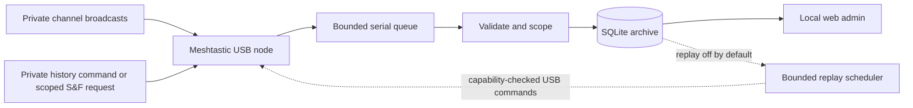

# Architecture and data rules

## Package boundaries

- `domain`: immutable message/replay rules; no web or USB ownership.
- `storage`: SQLAlchemy queries, SQLite transactions and packaged Alembic migrations.
- `transport`: version-pinned Meshtastic SDK adapters and the USB bridge wire protocol.
- `services`: ingestion, a single USB worker, cross-process ownership and replay pacing.
- `web`: authenticated FastAPI API, Jinja template, local CSS/JS/SVG and language catalogs.
- `diagnostics`: opt-in synthetic client probes, separate from ordinary capture.

The serial adapter blocks generic `ToRadio.packet` transmission. A narrow PKI
receipt path responds to authorized channel-administration DMs; history uses the
capability-checked bridge. The server
uses one worker and a bounded frame queue; reconnect does not promise recovery of
messages missed during an outage. HTTP reads and writes use separate SQLAlchemy
connections; SQLite uses WAL, FULL synchronous commits and a 5-second busy timeout.

## Archive eligibility and identity

Only decoded UTF-8 broadcast text from enabled private channels with full 16/32-byte
keys is eligible. Default key aliases and their expanded values, direct/PKI,
MQTT, telemetry, control, `/history` and `/channel` commands (including invalid syntax) and S&F
replay traffic are excluded. Configuration must
complete before packets are accepted.

An archive binds to one node identity. A per-database secret derives an HMAC scope
from channel settings and LoRa configuration. A changed key at the same channel
index therefore does not join the previous conversation. USB configuration frames
and node-discovered keys are not stored; explicitly registered catalogue PSKs are
encrypted in a separate table. Message text and decoded Data remain plaintext.
Raw PhoneAPI envelopes contain decoded messages for node-local channels and
encrypted payloads for server-decoded channels; this is not a blind unknown-key
archive or a complete RF packet capture.

Deduplication compares scope, sender, packet ID and canonical decoded Data within
a configurable host-time window (default 24 hours). Same identity with different
content is retained as a collision. After the window the same ID can start a new
record. Host receipt time controls retention; node timestamps remain metadata.

Names are loaded from NodeInfo records during the USB configuration handshake
and updated by subsequent announcements. The bounded startup queue holds up to
2048 frames. Only node number and display name are persisted from these records;
chat queries join the current name, so existing messages also gain the name.
An unknown name falls back to the node ID. Names are labels, not authentication.

## Replay boundaries

The experimental profile uses original author, a fresh outer transport ID and
`StoreAndForward.original_id`. The durable replay-ID ledger is reserved before
USB submission and survives message retention. It excludes known original IDs and
previous reservations; it cannot guarantee against all future/unknown 32-bit ID
collisions. Do not reuse the original sender/ID to encrypt changed content.

A broadcast `/history <hours>` command on TEXT_MESSAGE_APP requests the current
private channel only. Native unicast S&F requests remain accepted only when their
channel context survives and PKI is absent. Both paths share the same limits and
queue. Maximum history is displayed in hours in the admin and stored in minutes.
Commands are filtered again during replay for archives created by older versions.
Requests are restricted to the current private channel/configuration scope. For
node-local replies, firmware validates a channel/LoRa digest and private-key
eligibility. For server-channel replies, the host validates scope and encrypts
the payload; firmware checks the LoRa digest and packet bounds. Both paths enforce
capabilities, airtime and queue capacity. USB retries reuse the exact session/token/bytes. Timeout ends
the job without blindly resending an ambiguous packet in a new session.

A single paced job, bounded control queue and cooldown constrain traffic. The
UI counter means **submitted to the USB node**, not confirmed radio delivery.
See [history replay](history-replay.md) for limits and client compatibility.

## Web trust boundary

The process defaults to loopback:18765 and requires a password from TOML on every
route. An explicit bind IP enables private LAN access. It checks allowed hosts,
throttles failed logins and blocks cross-origin writes
using origin checks and a process-specific CSRF token, and serves a restrictive
CSP. User-controlled message/node/channel text uses `textContent`, not HTML.
There is no multi-user authorization boundary. The host OS, administrator and USB
host are trusted. Local hostile processes are outside this application's protection.

Browser language and selected section are local preferences, not shared database
settings. Translations use explicit keys; user messages are never translated.

## Server-managed channels

The channel catalogue keeps encrypted PSKs separately from archive channel labels.
A separate master-key file is required for restore. Ingestor normalizes an
unambiguous encrypted broadcast into Data using configured server keys before
capture/replay dispatch. Virtual channel indices start above physical USB slots.
Revision 3 adds bounded USB-only host-encrypted unicast submission; its host
service is the authorization boundary because firmware cannot inspect ciphertext.
Remote registration uses pinned PKI public keys and a durable request ledger.
See [server channel design and limits](server-channels.md).
